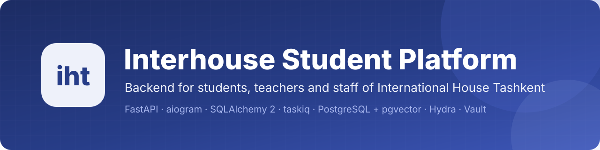
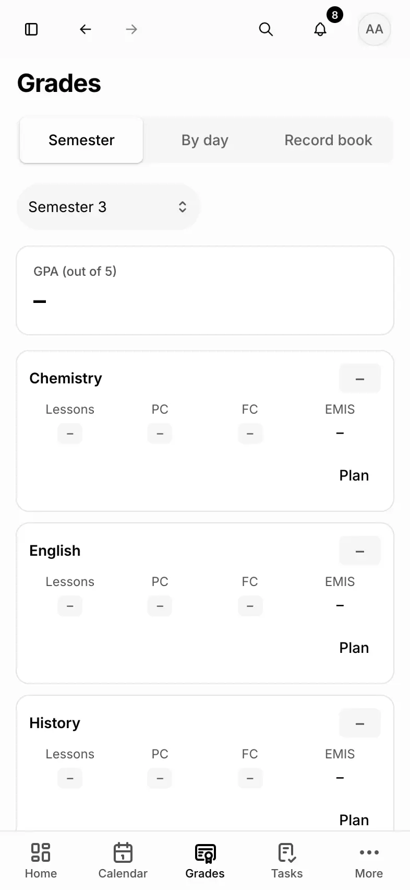
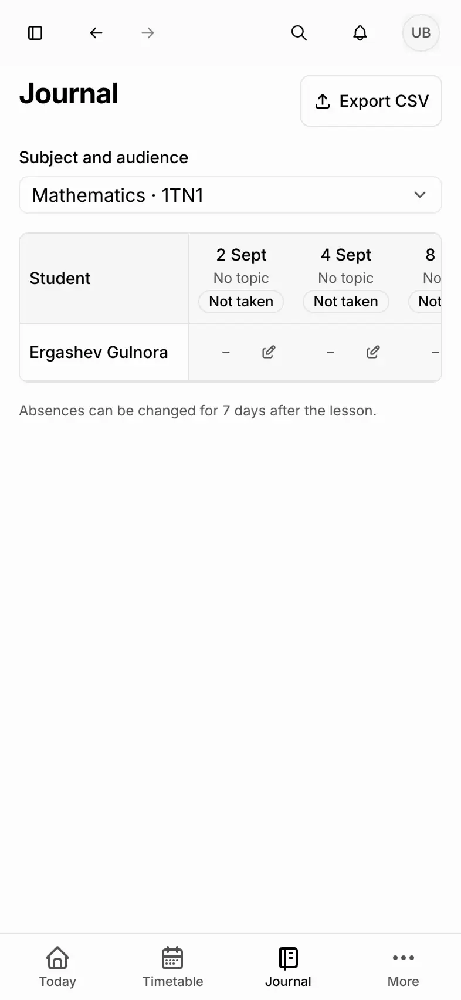
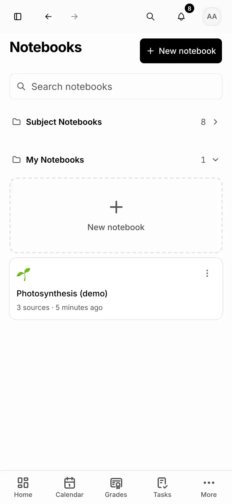
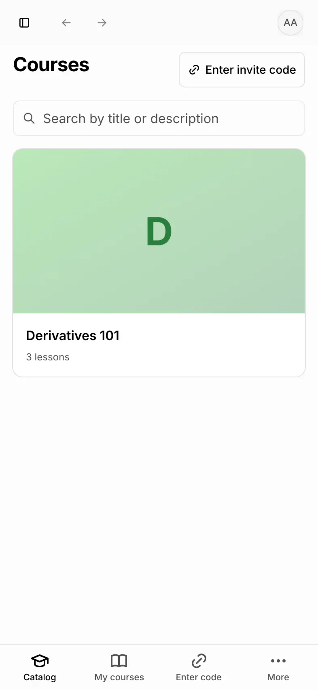
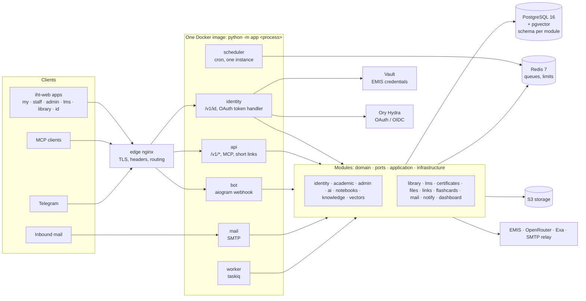

<p align="center">
  
</p>

<p align="center">
  <a href="https://github.com/interhousedev/ihsp-backend/actions/workflows/test.yml"></a>
  <a href="https://github.com/interhousedev/ihsp-backend/actions/workflows/lint.yml"></a>
  <a href="https://github.com/interhousedev/ihsp-backend/actions/workflows/codeql.yml"></a>
  <a href="https://github.com/interhousedev/ihsp-backend/actions/workflows/build.yml"></a>
  <a href="LICENSE"></a>
  
</p>

<p align="center">
  <b>The open-source backend of my.iht: one platform for the students, teachers, curators, librarians and
  administrators of the Academic Lyceum International House Tashkent.</b>
</p>

<p align="center">
  <a href="#quick-start">Quick start</a> ·
  <a href="#feature-tour">Features</a> ·
  <a href="#architecture">Architecture</a> ·
  <a href="#security">Security</a> ·
  <a href="#deployment">Deployment</a> ·
  <a href="CONTRIBUTING.md">Contributing</a> ·
  <a href="SECURITY.md">Report a vulnerability</a>
</p>

---

## What is IHSP

IHSP (Interhouse Student Platform) connects to students' EMIS accounts and covers daily school life: calendar and timetable, marks and the teacher journal, homework, attendance and work-offs, an AI study assistant with notebooks and a Studio for quizzes, flash cards and slides, a library, courses (LMS), files and links, a student mailbox and a Telegram bot. Every user-facing text exists in Uzbek, Russian and English.

This repository holds the Python backend, the compose files, the edge nginx, the Hydra and Vault configuration and the deployment scripts. The web apps live in the sibling repository [`iht-web`](https://github.com/interhousedev/ihsp-frontend); the two meet at [`openapi/openapi.json`](openapi/openapi.json).

## Feature tour

| | |
|---|---|
| <br>**Home.** Today's lessons, deadlines, marks and notices in one view. | <br>**Timetable.** Synced from EMIS, Monday to Friday, with room pages. |
| <br>**Marks.** Current and temporary marks, GPA, ПК and ИК, a planner. | <br>**Teacher journal.** Marks, attendance, work-offs, EMIS reconciliation. |
| <br>**AI assistant.** Tools for the school knowledge base, web search and generative UI blocks, with soft limits and a usage ledger. | <br>**Notebooks and Studio.** Sources in, grounded answers, quizzes, flash cards and slides out. |
| <br>**Library.** Catalogue, loans, a reader with reading plans, public book pages. | <br>**Courses (LMS).** Authoring, Common Cartridge import, certificates. |

Also: IHT ID single sign-on with passkeys, a Telegram bot (`@ihspbot`), inbound student mail, short links and shares, MCP servers, an admin console with limits, logs, knowledge and feedback.

## Quick start

```bash
git clone https://github.com/interhousedev/ihsp-backend.git iht-backend
cd iht-backend
uv sync --frozen
scripts/dev.sh all        # dev compose services, migrations, every HTTP router on :8000
```

Every external service (EMIS, OpenRouter, Exa, Telegram) runs in a deterministic fake mode by default, so no key is needed. See [Local development](#local-development) for the worker, the bot, demo data and the full stack in Docker.

## Apps and hosts

Production domain: `ihsu.uz` (the compose files build every host name from `DOMAIN`).

| Product | Host | Served by |
|---|---|---|
| my.iht (students) | `my.ihsu.uz`, installable app on `app.ihsu.uz` | iht-web `apps/sp` |
| IHT Учителям (teachers, curators) | `staff.ihsu.uz` | iht-web `apps/staff` |
| admin.iht (administration) | `admin.ihsu.uz` | iht-web `apps/admin` |
| lms.iht (courses) | `lms.ihsu.uz` | iht-web `apps/lms` |
| library.iht | `lib.ihsu.uz` | iht-web `apps/library`, public book pages by the `api` process |
| IHT ID (sign-in, single sign-on) | `id.ihsu.uz` | iht-web `apps/id` plus Ory Hydra |
| Shares, short links | `s.ihsu.uz` | iht-web `apps/share`, short links by the `api` process |
| API, MCP | `api.ihsu.uz`, `mcp.ihsu.uz` | this repository |

Other hosts: room pages `ihsu.uz/r/{room}`, inbound mail `mail.ihsu.uz`, the Telegram bot `@ihspbot`.

## Architecture

A modular monolith in Python 3.13: FastAPI, aiogram 3, SQLAlchemy 2 (async, asyncpg), Alembic, taskiq on Redis. One Docker image runs several processes (`python -m app <process>`):

| Process | Serves |
|---|---|
| `identity` | `/v1/id/*`, the OAuth token handler `/v1/oauth/*`, the Hydra hook, the internal EMIS gateway. Holds the Vault AppRole and the JWT-bearer signing key |
| `api` | every other `/v1/*` route, MCP servers, short links, room pages, public library pages |
| `bot` | Telegram webhook (production) or polling (development) |
| `mail` | inbound SMTP for `mail.ihsu.uz` |
| `worker` | taskiq tasks: EMIS sync, file processing, notifications, mail, embeddings, notebooks |
| `scheduler` | taskiq cron, exactly one instance |
| `migrate` | `alembic upgrade heads` and the Hydra migration, then exits |
| `all` | development only: every HTTP router on port 8000 |

Infrastructure: PostgreSQL 16 with pgvector (one schema per module), Redis 7, S3-compatible storage (RustFS locally, a provider bucket in production), HashiCorp Vault for EMIS credentials, Ory Hydra for OAuth and OpenID Connect, OpenRouter for language models, Exa for web search, an external SMTP relay for outgoing mail.

Every module owns a PostgreSQL schema and never reads another module's tables. Inside a module the layers are `domain`, `ports`, `application`, `infrastructure` and `wiring.py`; the process entry points are in `app/interfaces/` (http, bot, mcp, smtp, jobs). The rules are in [CODESTYLE.md](CODESTYLE.md).



## Security

The full policy and the disclosure process are in [SECURITY.md](SECURITY.md). In short:

- **Sign-in.** IHT ID runs on Ory Hydra (OAuth 2.0 and OpenID Connect, authorization code with PKCE for every web app). Refresh tokens live in `HttpOnly` cookies behind a token handler on the `identity` process; passkeys, one-time admin codes and password policy are enforced server side. Only the `identity` process holds the Vault AppRole and the JWT-bearer signing key.
- **Secrets.** EMIS credentials are encrypted with Vault transit and stored in Vault KV, never in PostgreSQL. With `IHSP_ENV=prod` the app refuses development secrets, fake modes and `localhost` URLs.
- **Rate limits and enumeration.** A Redis fixed-window limiter guards sign-in, registration, codes and public endpoints; answers do not reveal whether an account exists.
- **AI access controls.** Every model call is a named AI task, passes an access guard (per-role and per-user access, soft limits changed at runtime) and is written to the usage ledger. Tools that change data need explicit user approval; guest bot users only reach the public knowledge base.
- **Generative UI.** OpenUI blocks in AI answers are parsed against a fixed catalogue, validated and repaired once by a small model; a block that is still broken or unsafe is dropped, and clients without OpenUI get a Markdown rendering. The model never ships raw HTML or script to a browser.
- **SSRF and uploads.** Outbound fetches (link checks, certificates, notebook sources) go through URL policies that refuse private, loopback and link-local addresses and handle redirects themselves; uploads are checked by content type (libmagic) against per-feature allowlists.
- **Supply chain.** CI pins actions by commit, builds the image with an SBOM and provenance attestations, scans it with Trivy (fixable critical and high findings fail the build), signs it with keyless cosign, and runs CodeQL and a secrets scan. Dependabot updates dependencies weekly.

## School knowledge base

The `knowledge` module holds school facts (rules, schedules, staff, procedures, contacts). Administrators edit them on the admin "Knowledge" page (`iht-web` route `apps/admin/src/app/(console)/knowledge`), backed by `app/interfaces/http/v1/admin_knowledge/`.

- Search is hybrid: pgvector similarity, pg_trgm similarity on key, title and value, and full text, fused by reciprocal rank.
- The AI assistants (`search_knowledge_base` tool) and the notebook chat look facts up through `KnowledgeSearchPort`. A search with zero hits notifies every administrator through `notify_knowledge_gap` (the query only, deduplicated for 24 hours); a failed notification is logged and ignored.
- Settings: `IHSP_KNOWLEDGE__VECTOR_MIN_SIMILARITY` (0.45), `IHSP_KNOWLEDGE__TRIGRAM_MIN_SIMILARITY` (0.2), `IHSP_KNOWLEDGE__CANDIDATES` (20, hits per signal before fusion), `IHSP_KNOWLEDGE__DEFAULT_LIMIT` (5).

## Repository layout

| Path | Content |
|---|---|
| `app/` | The application: `bootstrap/` (one composition root per process), `modules/<name>/`, `interfaces/`, `shared/`, settings |
| `migrations/` | Alembic, one branch per module (see `migrations/README.md`) |
| `tests/` | Unit, HTTP, model/migration, integration and deployment tests, fakes for every port in `tests/fakes/` |
| `materials/` | Compose files (`docker-compose.dev.yaml`, `.local.yaml`, `.prod.yaml`), nginx, Hydra, Vault, certbot, env samples |
| `scripts/` | `dev.sh`, `local_up.sh`, `local_down.sh`, `cloud_deploy.sh`, `prod_init.sh`, `backup.sh`, `export_openapi.py`, seeds and smoke tests |
| `openapi/openapi.json` | The exported OpenAPI document, the contract with iht-web |
| `locales/` | Translations (uz, ru, en) |
| `.github/` | CI workflows, Dependabot, issue and pull request templates, CODEOWNERS |
| `.claude/skills/` | Project skills for coding agents (security review, testing, migrations, API contract, bot, OpenUI, copy, AI Studio) |
| `docs/assets/` | README banner and screenshots |

## Prerequisites

- Docker 28 or newer with compose v2.
- [uv](https://docs.astral.sh/uv/) (it installs Python 3.13).
- [Bun](https://bun.sh) 1.3, because the local full stack builds the web apps on the host.
- `libmagic` (`brew install libmagic` on macOS; the Docker image already has it).
- For the local full stack, a checkout of `iht-web` next to this repository (`../iht-web`), or its path in `IHSP_WEB_DIR`.

## Local development

Mode 1, infrastructure in Docker and code on the host:

```bash
scripts/dev.sh all          # starts the dev compose services, migrates, serves every HTTP router on :8000
scripts/dev.sh worker       # taskiq worker (second terminal)
scripts/dev.sh scheduler    # cron (third terminal, exactly one)
scripts/dev.sh bot          # Telegram bot (polling, or fake)
uv run python scripts/hydra_bootstrap.py   # once: registers the OAuth clients in Hydra
uv run python -m app seed-demo             # once: demo term, groups, timetable, users
```

The API is on `http://localhost:8000`, Hydra on `http://localhost:4444`, Mailpit (login codes) on `http://localhost:8025`. The web apps run from the `iht-web` checkout with `bun run dev` and call these ports directly.

Mode 2, the whole product in Docker (`*.localhost`, plain HTTP, fake EMIS, OpenRouter and Telegram):

```bash
scripts/local_up.sh          # build, start, register the OAuth clients, seed demo data
scripts/local_down.sh        # stop; add --wipe to delete the data
```

`local_up.sh` needs the `iht-web` checkout (`../iht-web` or `IHSP_WEB_DIR=/path/to/iht-web`) and stops with an error if it is missing. It builds the seven web apps on the host one at a time and packs them with `deploy/Dockerfile.prebuilt` of the web repository, so the Docker VM never runs `next build`. Options: `--no-build`, `--full-build` (build the web image inside Docker; needs a large Docker VM), `--no-seed`. Open `http://my.localhost/` and sign in with a demo login.

Demo logins (local stack only): `admin.ihsp` / `AdminDemo1` (the admin one-time code arrives in Mailpit), `usmonov.bobur` / `TeacherDemo1`, `abdullayev.alisher` / `StudentDemo1`, `tursunov.sardor` / `LibrarianDemo1`.

## Configuration, fake and real modes

All settings are `IHSP_*` environment variables, nested with `__` (for example `IHSP_DATABASE__POOL_SIZE`). `IHSP_ENV_FILE` takes a comma-separated list of dotenv files; later files override earlier ones and a `?` prefix marks a file optional. Templates are `materials/.env.sample`, `materials/.env.local.sample` and `materials/.env.prod.sample`. With `IHSP_ENV=prod` the app refuses development secrets, fake modes and `localhost` URLs.

By default every external service runs in a fake, deterministic mode that needs no key:

| Service | Mode variable | Real mode also needs |
|---|---|---|
| EMIS | `IHSP_EMIS__MODE` | EMIS access of registered students |
| OpenRouter | `IHSP_OPENROUTER__MODE` | `IHSP_OPENROUTER__API_KEY` |
| Exa | `IHSP_EXA__MODE` | `IHSP_EXA__API_KEY` |
| Telegram | `IHSP_TELEGRAM__MODE` | `IHSP_TELEGRAM__BOT_TOKEN`, `IHSP_TELEGRAM__BOT_USERNAME` |

Secrets live only in git-ignored files: `.env.local` (copy `materials/.env.local.sample`, used by `local_up.sh`), `materials/dev-keys/secrets.env` (used by `scripts/dev.sh`), `.env.prod` and `secrets/`. Never commit or print a key.

## Tests and checks

The tests need the dev compose services (Postgres with pgvector, Redis, S3, Vault):

```bash
docker compose -f materials/docker-compose.dev.yaml up -d --wait postgres redis s3 s3-init vault vault-init
uv sync --frozen
IHSP_ENV_FILE=materials/dev.env uv run pytest -q -p no:cacheprovider     # everything
uv run pytest tests/<module>/unit -q                                      # unit tests need no services
scripts/style_check.sh      # black --check, isort --check-only, flake8, mypy
scripts/test.sh             # pytest with coverage
```

`tests/deploy` parses the Dockerfiles, nginx templates and compose files and runs `docker compose config` and `nginx -t`, so it needs Docker.

## API contract with iht-web

`openapi/openapi.json` is the contract. After any change of a route or schema:

```bash
IHSP_ENV_FILE=materials/dev.env uv run python scripts/export_openapi.py
git add openapi/openapi.json
```

CI fails when the committed document differs from the export. Then, in the `iht-web` checkout, run `bun run sync:openapi` (it copies this file to `packages/api/openapi.json` and regenerates the typed client) and commit the result there.

## Deployment

One Docker host runs everything: PostgreSQL, Redis, Vault, Hydra, the backend processes, the `web` image (static apps), the edge nginx with Let's Encrypt, and certbot. The server pulls images built by CI (`ghcr.io/<owner>/ihsp-backend` and `ihsp-web`); nothing is built on it.

1. Server: Linux with Docker and the compose plugin, at least 4 vCPU and 8 GB RAM, ports 25, 80 and 443 open, an SSH user in the `docker` group that owns `/opt/ihsp`.
2. DNS: A/AAAA records for `ihsu.uz`, `id`, `my`, `app`, `staff`, `admin`, `lms`, `lib`, `s`, `api`, `mcp`, `logs` and `mail`; an MX record for `mail.ihsu.uz`; SPF, DKIM and DMARC TXT records for the mail domain.
3. Object storage: a bucket and an access key at an S3 provider (or the bundled RustFS profile).
4. Accounts: OpenRouter, Exa, a Telegram bot from @BotFather, an outgoing SMTP relay, EMIS access.
5. `cp materials/.env.prod.sample .env.prod` and fill in the `>>> SET <<<` values (`DOMAIN`, `ACME_EMAIL`, `IMAGE_OWNER`, `TAG`, S3, Telegram, OpenRouter, Exa, SMTP). The file is a secret: mode 600, never committed.
6. `scripts/cloud_deploy.sh deploy@<server> --init` copies the files, generates the remaining secrets and the JWT key (`prod_init.sh env`), then runs `prod_init.sh init`: images, PostgreSQL and Redis, Vault initialisation and unseal, TLS certificates, migrations, Hydra and its OAuth clients, the S3 bucket, all services, and the first administrator with a one-time activation link. Production never runs seed data.
7. After the first deployment move `secrets/vault-init.txt` (five unseal keys and the root token) off the server into a password manager and delete it. Install the cron lines that `prod_init.sh` prints (certificate renewal reload, nightly `scripts/backup.sh --keep 14`). Check `https://api.<domain>/health` and open the admin app's Limits & usage page to review the AI limits.

Updates and rollback: `scripts/cloud_deploy.sh deploy@<server> --tag 1.1.0`. It keeps the server's `.env.prod` (`--push-env` overwrites it), pulls images, runs the Hydra and app migrations (a failing migration stops the deploy before any process is replaced) and starts everything. Rollback is `--tag <previous>`; migrations are forward only, so a schema-changing release may need a restored backup.

Vault is a single node and starts sealed after every reboot. Until it is unsealed, registration and EMIS sync pause. Unseal with `ssh -t deploy@<server> 'cd /opt/ihsp && scripts/prod_init.sh unseal'`.

Backups: `scripts/backup.sh` dumps both databases, a Redis snapshot and a Vault Raft snapshot, encrypts them to the public key `BACKUP_AGE_RECIPIENT` (keep the private key off the server) and optionally uploads them to a versioned S3 bucket.

Error tracking: self-hosted Bugsink (`bugsink/bugsink`, Sentry-compatible) at `logs.<domain>` receives errors, stack traces and WARNING+ log records from every backend process and, when `NEXT_PUBLIC_BUGSINK_DSN` is set, from the browser apps. Events live in a `bugsink` PostgreSQL database: `BUGSINK_DB_MODE=main` (default) creates it in the main PostgreSQL, `dedicated` runs a separate container. `scripts/backup_bugsink.sh` uploads a nightly encrypted dump to the `sp-logs` bucket (`BUGSINK_BACKUP_S3_*`). After the first start, create a project in the Bugsink UI and set `IHSP_BUGSINK__DSN`; set `IHSP_BUGSINK__API_URL` and `IHSP_BUGSINK__API_TOKEN` so the admin app's Logs page (`GET /v1/admin/logs/issues`) lists recent issues with links to Bugsink. An empty DSN or token turns each part off.


AI spending is capped by soft limits (`IHSP_LIMITS__*`) that administrators change at runtime on the Limits & usage page; every model call is recorded in the usage ledger. Set a hard spending cap at OpenRouter and at Exa as well.

Verify an image signature with `cosign verify ghcr.io/<owner>/ihsp-backend@<digest> --certificate-identity-regexp 'github.com/<owner>/' --certificate-oidc-issuer https://token.actions.githubusercontent.com`.

## Continuous integration

| Workflow | When | What |
|---|---|---|
| `lint.yml` | every push and pull request | black, isort, flake8, mypy |
| `test.yml` | pull requests to `main` | the whole pytest suite against the dev compose services, the committed `openapi.json` check, a secrets scan |
| `build.yml` | pushes to `main`, tags `v*`, manual | builds `ghcr.io/<owner>/ihsp-backend`, SBOM and provenance, Trivy scan (fails on fixable critical and high findings), keyless cosign signature, channel tags |
| `codeql.yml` | pull requests, `main`, weekly | CodeQL for Python |

Dependabot updates the actions, the base images, the compose images and the Python dependencies weekly. Release: push a tag `v1.2.3`; the image is published as `1.2.3`, `1.2` and `sha-<commit>`.

## Contributing

Read [CONTRIBUTING.md](CONTRIBUTING.md) before you open a pull request: setup, tests first, the commit convention and the API contract workflow. [CODESTYLE.md](CODESTYLE.md) has the coding rules, [CLAUDE.md](CLAUDE.md) and [`.claude/skills/`](.claude/skills) have the instructions for coding agents. Everyone taking part follows the [Code of Conduct](CODE_OF_CONDUCT.md). Report vulnerabilities privately as described in [SECURITY.md](SECURITY.md), never in a public issue.

## License

Copyright (C) 2026 Alex Sayfi and contributors.

IHSP is free software under the [GNU Affero General Public License v3.0 only](LICENSE) (`AGPL-3.0-only`). You may use, study, change and share it. If you run a modified version as a network service, you must offer its users the corresponding source code of your version under the same licence.
